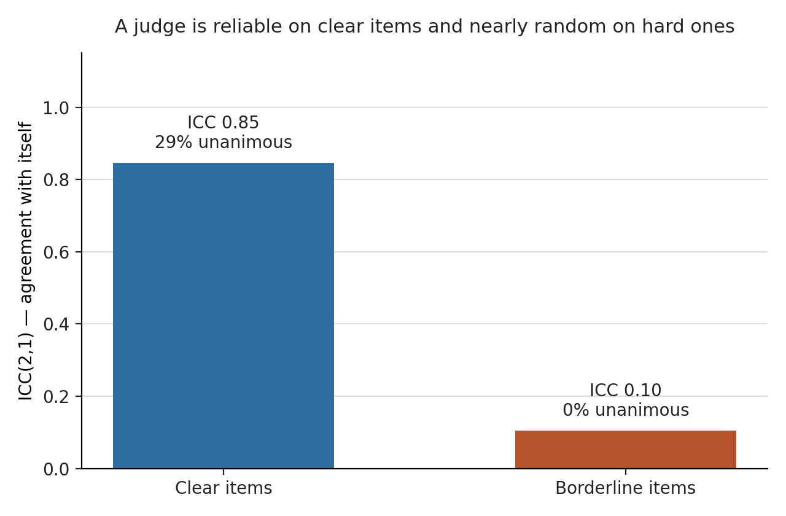
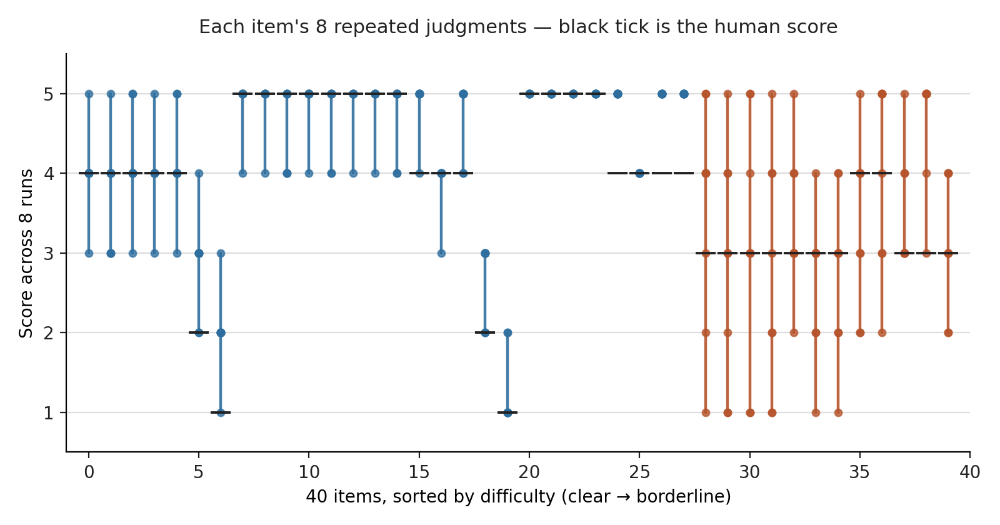
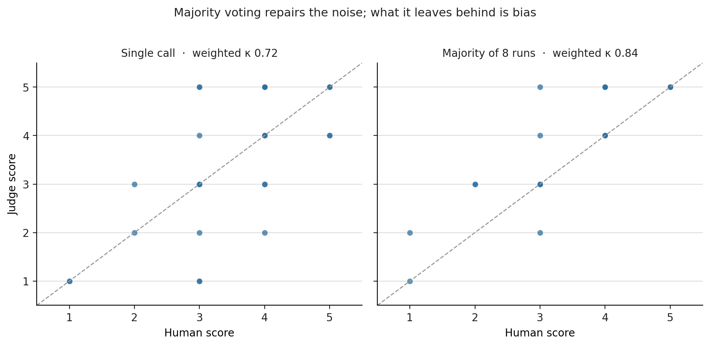

# Can you trust an LLM judge?

[](https://github.com/emma-khare/llm-judge-agreement/actions/workflows/reproduce.yml)

**Emma Khare** — a methods study in whether AI-generated evaluations can be trusted.

Teams increasingly use one language model to grade another's output ("LLM-as-judge"). The
evidence usually offered is a percentage: *the judge agreed with humans 85% of the time.*
This repository asks the two questions that percentage cannot answer:

1. **Does the judge agree with itself?** Grade the same item repeatedly. If the scores move,
   every decision built on a single call inherits that noise.
2. **Does it agree with a person, once you subtract luck?** Raw agreement is inflated by
   lopsided labels, so the headline statistic here is Cohen's kappa, with a bootstrap
   interval — and quadratic-weighted kappa for the ordinal 1-5 scores.

And then the question that decides whether the usual remedy works: **is the disagreement
noise, which repetition can average away, or bias, which it cannot?**

> **Status: method demonstration.** The 40 items are synthetic and the judge is a
> *simulated* model (`src/judge_reliability/mock_judge.py`) whose behaviour is described
> and parameterised in that file. These numbers show the pipeline working and what it
> would report; they are **not** a finding about Claude or any other model. One line —
> the client — turns this into a live study. See [LIMITATIONS.md](LIMITATIONS.md).

## Results

Run `python3 analysis.py`. 40 items, 8 judgments each, simulated judge at temperature 0.7.

### 1. Does the judge agree with itself? (test-retest)

| Group | n | ICC(2,1) | Unanimous across 8 runs | Mean within-item SD |
|---|---|---|---|---|
| Overall | 40 | 0.64 | 20% | 0.57 |
| Clear items | 28 | **0.85** | 29% | 0.34 |
| Borderline items | 12 | **0.10** | **0%** | 1.11 |

The judge is close to a random number generator on the items that need judgment. **Not one
borderline item received the same score eight times in a row.**

### 2. Does it agree with the annotator?

| Measure | Single call | Majority of 8 runs |
|---|---|---|
| Quadratic-weighted kappa (1-5) | 0.72 | 0.84 |
| Cohen's kappa (binary gate at ≥ 4) | 0.67 | 0.89 |
| Raw agreement | 85% | 95% |
| Chance agreement | 55% | 56% |
| Exact match (1-5) | 52% | 70% |
| Within 1 point | 88% | 98% |
| Mean signed error (judge − human) | +0.05 | +0.28 |

95% bootstrap interval on the single-call binary kappa (2,000 resamples): **[0.39, 0.89]**.
Note how wide it is. On 40 items a kappa is an estimate with a vista, not a verdict.

Split by difficulty, the single call scores **0.86 weighted kappa on clear items and −0.08
on borderline ones** — worse than chance on exactly the items where a human is needed.

### 3. What repetition fixes

Of the 6 single-call disagreements, the majority vote repaired **5** — the judge was capable
of the right answer and that sample missed it. **1 survived**, because every run made the same
wrong call. That one is bias, and no amount of repetition removes it; only a different rubric,
prompt, or threshold does.

## Why the two earlier versions of this study disagreed

This repository merges two earlier projects that reported κ = 0.34 and κ = 0.98 for what
looked like the same claim. They cannot both describe one judge:

- **0.34** came from a single pass of a judge that answered "acceptable" 90% of the time
  against a human who said it 60% of the time. Its errors were *structural leniency*, which
  repetition reproduces exactly.
- **0.98** came from majority-voting eight calls of a judge with run-to-run noise but no
  leniency. Averaging removes that noise almost completely.

Neither number is wrong; each is a statement about a different error process. The merged
study measures both on one dataset, and reports the split (5 noise errors, 1 bias error) that
neither earlier version reported. **A judge's kappa depends on how its errors are made, not
only on how many it makes** — which is why "the judge agrees 85% of the time" is not a
validation.

## Sanity check: reliability is not validity

```bash
python3 analysis.py --temperature 0
```

At temperature 0 the simulated judge repeats itself perfectly: ICC **1.00**, 100% of items
unanimous, within-item SD 0.00. Its kappa is still only **0.94**, and its exact match 78%:
it is *consistently* a little too generous. Perfect stability, imperfect accuracy. A
reliability statistic alone cannot tell you a judge is right.

## What's here

| Path | What it is |
|------|-----------|
| `analysis.py` | The whole study in one command; standard library only |
| `src/judge_reliability/dataset.py` | 40 items, the rubric, and the score→label threshold |
| `src/judge_reliability/judge.py` | One call to the judge: prompt, JSON parsing, the client seam |
| `src/judge_reliability/mock_judge.py` | The simulated judge, with its assumptions as named constants |
| `src/judge_reliability/reliability.py` | ICC, kappa (nominal and weighted), bootstrap CI, majority vote, error decomposition |
| `src/judge_reliability/charts.py` | The three figures (matplotlib, optional) |
| `data/judge_runs.csv` | The recorded 8 runs per item, for inspection |
| `reports/` | The figures |
| `LIMITATIONS.md`, `NEXT_STEPS.md`, `BUILD_LOG.md`, `REBUILD.md` | Constraints, extensions, build record, the rebuild exercise |

## Figures





## Reproduce

```bash
python3 analysis.py            # the report; no install, no API key
python3 analysis.py --json     # machine-readable
python3 analysis.py --runs 12 --temperature 0.3
python3 analysis.py --save-runs   # rewrite data/judge_runs.csv
python3 analysis.py --charts      # needs matplotlib
```

Charts need one dependency:

```bash
python3 -m venv .venv
.venv/bin/python -m pip install -r requirements.txt
.venv/bin/python analysis.py --charts
```

The study is deterministic for a given seed (`--seed`, default 11), so the numbers above are
reproducible exactly — and CI checks it: every push regenerates the report and fails if the
README has stopped quoting what the code produces.

```bash
python3 -m unittest discover -s tests -t . -v
```

## Run it live

```bash
python3 -m venv .venv && .venv/bin/python -m pip install anthropic
export ANTHROPIC_API_KEY=...          # or put it in .env, which is git-ignored
PYTHONPATH=src .venv/bin/python -c "
import anthropic
from judge_reliability.reliability import run_study
r = run_study(anthropic.Anthropic(), n_runs=8, temperature=0.7)
print(r['test_retest']['borderline']['icc'], r['single_call']['cohens_kappa'],
      r['majority_vote']['cohens_kappa'])
"
```

That is 320 API calls for 40 items × 8 runs. Set `JUDGE_MODEL` to change the model
(default `claude-sonnet-4-5`). Nothing else changes: `judge_once` and the whole reliability
engine are client-agnostic.

Then change one line in that call — pass a real client in place of `MockAnthropic()` — and
every number above becomes a claim about a real model, which is the only way any of it
becomes a finding.

## What this claims — and does not

**Claims:** a working pipeline that measures an LLM judge on both axes (self-agreement and
human agreement), corrects for chance, quantifies uncertainty, and separates noise from bias;
and, on a simulated judge, the demonstration that reliability collapses on ambiguous items
while a majority vote recovers the noise part and leaves the bias part standing.

**Does not claim:** anything about a specific real model's reliability, or that these numbers
would survive a change of rubric, threshold, model, or temperature. See
[LIMITATIONS.md](LIMITATIONS.md).

## Stack

Python 3.9+ · standard library for everything statistical (no numpy, no scikit-learn) ·
`matplotlib` only for figures · `anthropic` only for live runs · synthetic data, generated
seeded, clearly labelled as such.
